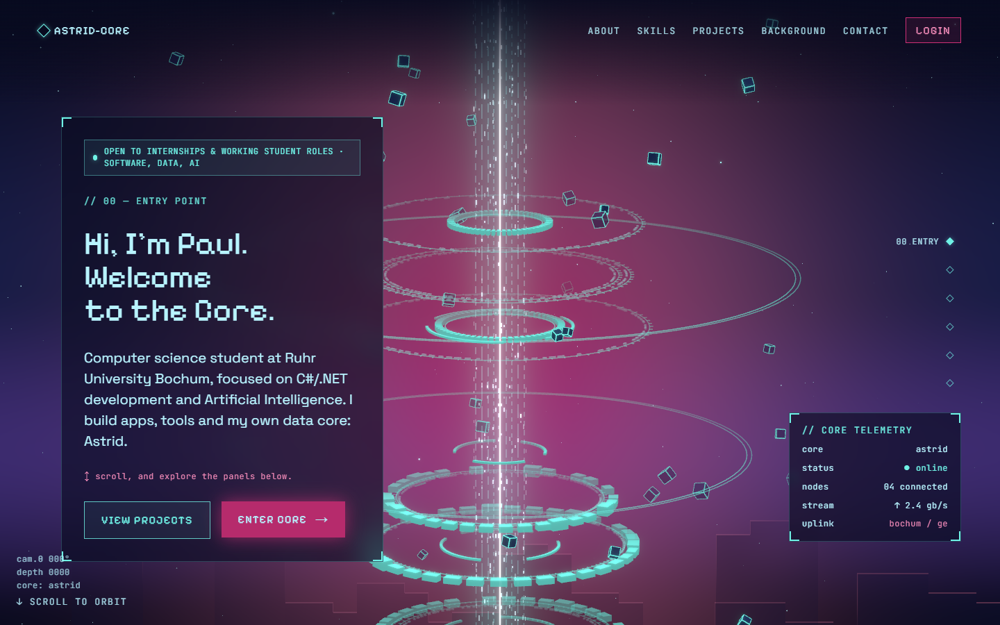

# astridcore.dev

My personal site and CV, built as one scroll down a data stream. The camera descends a WebGL beam and orbits it, passing six stations: Entry, About, Skills, Projects, Background and Contact. At the bottom, "Enter Core" will lead to a private area with a chat to Astrid, my local AI assistant.

**Live:** [astridcore.dev](https://astridcore.dev)



## Stack

- **Next.js 16** (App Router, Turbopack), **React 19**, **TypeScript**
- **Tailwind CSS 4**, with every color, size and spacing value taken from design tokens
- **React Three Fiber / three.js** for the stream: beam, rings, cubes, skyline, dust and the spacetime well at the bottom, plus a bloom pass
- **Zustand** shares the scroll position between the page and the 3D scene
- **Playwright** for visual checks and tests

## How it works

- **Scroll drives the camera.** Each section is one station. The camera depth and the orbit angle are measured from the section positions, so the stream moves in lockstep with the page.
- **Content stays HTML.** The panels are plain DOM over a fixed canvas, so the text is readable and indexable without WebGL.
- **Panels power on like an old CRT** the first time they scroll into view, and thin circuit traces tie them to the beam.
- **Reduced motion is respected.** With `prefers-reduced-motion`, the stream is a still image and the panels simply appear.

The design lives in Figma. [`DESIGN.md`](DESIGN.md) holds the tokens and specs, and [`PRODUCT.md`](PRODUCT.md) covers who the site is for and what it has to do.

## Run it locally

Needs Node 20 or newer.

```bash
npm install
npm run dev        # http://localhost:3000
```

Other scripts:

```bash
npm run build      # production build
npm run typecheck  # TypeScript
npm run lint       # ESLint
npm run test       # Playwright (first run: npm run test:install)
```

## Project layout

```
src/
  app/        layout, page, global styles, panel power-on
  sections/   one file per station (00 Entry … 05 Contact); the page text lives here
  scene/      the WebGL stage: stream, sky, skyline, dust, emitter floor, camera
  chrome/     nav, orbit rail, HUD, tethers
  ui/         panels, buttons, chips and other building blocks
  store/      scroll and core state
tests/        Playwright specs
docs/         Figma reference frames and the README screenshot
```

## Related

- [Astrid](https://github.com/Paul-Uni/Astrid): the local AI desktop assistant this site is named after

---

© 2026 Paul Onyeikedi. The code is public so you can see how it's built. The texts, design and images are mine.
